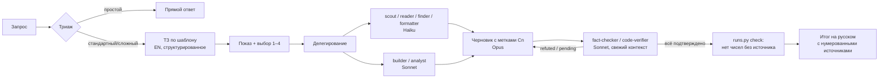

# Conductor — оркестровка и круговая верификация для Claude Code

Плагин для Claude Code. Opus (или Fable — по явному указанию) планирует, принимает решения и пишет итог. Рутину выполняют дешёвые агенты на Haiku и Sonnet. Каждый факт, число и строка кода перед выдачей проходят независимую проверку. Вместо повторного сканирования проекта плагин поддерживает инкрементальную карту: при изменении файла переиндексируется только он и связанные с ним файлы.

Три класса задач: **технологические исследования**, **разработка игр и приложений**, **анализ данных**.

## Что получаете

| Проблема | Решение в Conductor |
|---|---|
| Дорогая модель сама ищет в вебе, читает PDF, форматирует таблицы | Маршрутизация: веб и документы → Haiku, код и расчёты → Sonnet, решения и синтез → Opus |
| Расплывчатый запрос, модель додумывает | Запрос превращается в структурированное ТЗ (шаблоны под исследование, разработку, аналитику). ТЗ показывается вам с вариантами 1–4 до запуска |
| «Да, моя ошибка» после проверки | Цикл *подготовка → независимая проверка → исправление → повторная проверка изменённого* до нуля открытых замечаний |
| Выдуманные или неточные источники, подмена понятий | Реестр утверждений (claims ledger): каждое утверждение в тексте имеет метку `[Cn]` и проверенный источник. Проверяющий отдельно сверяет определения метрик |
| Утверждение исправили после проверки | Вердикт привязан к конкретной версии утверждения, включая файлы данных расчёта и посылки вывода. Любое изменение возвращает утверждение на проверку |
| Число без источника | Скрипт блокирует выдачу, если в финальном тексте есть число или дата без ссылки на проверенное утверждение |
| Сканирование всего проекта при каждом изменении | Карта `.conductor/MAP.md` + карточки модулей. Хуки переиндексируют только изменённый файл и сообщают, какие зависимые файлы проверить |
| Непонятно, куда ушёл лимит | Журнал токенов по моделям и агентам, команда `/conductor:tokens` |

## Честно о границах

- **100 % точность не гарантирует ни одна система.** Conductor разделяет то, что обеспечивается механически, и то, что оценивает модель.
  - *Механически, скриптом:* единый формат записей (некорректные отклоняются целиком); вердикт действует только для той версии утверждения, которую проверили; каждая фраза итога помечена; числа совпадают с процитированными утверждениями; задача завершается только через `finalize`, который требует отчёт проверяющего.
  - *Суждением проверяющего агента:* действительно ли источник подтверждает смысл утверждения, совпадают ли определения метрик, нет ли факта во фразе, помеченной `[~]`. Здесь проверяющий может ошибиться. Поэтому проверку выполняет независимый агент в чистом контексте, а неподтверждённое показывается явно, а не скрывается.
  - Если первоисточник сам ошибается или источники расходятся, система покажет это, а не скроет.
- **Верификация стоит токенов.** Экономия достигается тем, что объёмную работу делают Haiku и Sonnet, в главный контекст возвращаются короткие сводки, а проверка повторяется только для изменённых утверждений. На задачах с высокой ценой ошибки система тратит больше, чем «просто спросить», но меньше, чем исправлять ошибки вручную. Реальный эффект измеряется командой `/conductor:tokens`.
- **Тариф Pro:** Opus 5.5 входит в лимиты плана, Fable 5.1 — нет: он списывается с usage-кредитов по ценам API. Поэтому Fable в Conductor включается только по вашему явному выбору.
- Подагенты расходуют тот же общий лимит плана, что и основной диалог, но дешёвые модели расходуют его медленнее.

## Установка

Нужны Claude Code (десктоп или CLI) и Python 3.8+. Внешних библиотек нет.

В любой сессии Claude Code:

```
/plugin marketplace add Elarhado/conductor
/plugin install conductor@conductor
```

Python находится автоматически (`python3`, `python` или `py`). Если он установлен под другим именем, укажите команду в настройке плагина `python` через `/plugin`. На Windows хукам нужен Git Bash; обычно он уже установлен вместе с Claude Code.

Затем в каждом проекте один раз:

```
/conductor:init
```

## Ежедневное использование

| Команда | Что делает |
|---|---|
| `/conductor:conduct <задача>` | Полный цикл: ТЗ → подтверждение → делегирование → проверка → выдача |
| `/conductor:conduct <задача> --fable` | То же, но ключевые решения принимает Fable (на Pro — из usage-кредитов) |
| `/conductor:verify <файл или run-id>` | Проверить готовый текст или ответ по циклу верификации |
| `/conductor:tokens [дни]` | Расход по моделям и агентам, доля делегированной работы |
| `/conductor:init` | Подключить проект: карта, карточки, конфиг |

Постоянная стоимость плагина — около 1 тыс. токенов контекста на сессию (описания скиллов и агентов, по данным `claude plugin details`). Тела скиллов и агентов загружаются только при вызове. Хуки контекст не расходуют, кроме короткой карты проекта в начале сессии.

Писать `/conductor:conduct` каждый раз не обязательно. В подключённом проекте хук начала сессии сообщает модели, что для нетривиальных задач нужно применять протокол. Простые вопросы обрабатываются без него.

## Как это работает



Подробнее:
- [docs/ARCHITECTURE.md](docs/ARCHITECTURE.md) — компоненты, потоки данных, хуки
- [docs/VERIFICATION.md](docs/VERIFICATION.md) — круговая верификация и реестр утверждений
- [docs/CODEMAP.md](docs/CODEMAP.md) — разметка проекта и инкрементальная индексация
- [docs/TOKEN-ECONOMY.md](docs/TOKEN-ECONOMY.md) — откуда берётся экономия и как её измерить
- [docs/CONFIG.md](docs/CONFIG.md) — все настройки

## Состав

```
.claude-plugin/plugin.json        манифест (настройка: команда python)
.claude-plugin/marketplace.json   чтобы ставить из GitHub одной парой команд
skills/conduct/                   протокол оркестратора + шаблоны ТЗ
skills/verify/                    цикл верификации
skills/codemap/                   работа с картой проекта
skills/init/                      подключение проекта
skills/tokens/                    отчёт по расходу
agents/                           9 субагентов (5 × Haiku, 4 × Sonnet)
hooks/hooks.json                  SessionStart, PostToolUse, Stop, SubagentStop
scripts/                          codemap.py, runs.py, usage.py (stdlib Python)
tests/                            тесты скриптов
```

## Лицензия

MIT
